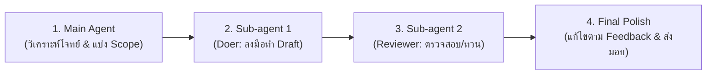

# Universal Delegated Execution & Review Pipeline (ระบบ Multi-Agent สำหรับทุกงาน)

สกิลนี้เป็นมาตรฐานกลางที่กำหนดให้ Codex **แตก Sub-agent แยกบทบาทการทำงานเสมอ (Separation of Concerns)** เพื่อแก้ปัญหาโมเดลทำงานรวบรัด ข้ามขั้นตอน หรือปล่อยให้มีข้อผิดพลาดหลุดรอด

---

## 1. กฎเหล็กสากล (Universal Multi-Agent Law)

> [!IMPORTANT]
> **หลักการ Maker-Checker (คนทำ vs คนตรวจ)**  
> ไม่ว่าจะเป็นงานประเภทใดก็ตาม **ห้ามให้ Context เดียวทั้งทำและตรวจประเมินตัวเอง**  
> ต้องแตก Sub-agents อย่างน้อย 2 บทบาทเสมอ:
> 1. **Doer / Maker (ผู้ลงมือทำ)**
> 2. **Reviewer / Auditor (ผู้ตรวจสอบและทวนความถูกต้อง)**

---

## 2. ตารางแปลงบทบาทตามประเภทงาน (Domain Adaptation Matrix)

ไม่ว่าผู้ใช้จะสั่งงานอะไร ให้จับคู่งานเข้ากับตารางนี้เพื่อแตก Sub-agents ให้ตรงหน้าที่:

| ประเภทงาน | Doer / Maker (Sub-agent 1) | Reviewer / Auditor (Sub-agent 2) |
| :--- | :--- | :--- |
| **งานเขียนโค้ด / Debug / System** | **Architect & Implementer**: เขียนโค้ด, แก้ไขไฟล์, รันคำสั่ง, สร้างฟังก์ชัน | **Code Auditor**: ตรวจ Security, Edge Cases, Type safety, Performance, Code smells |
| **งานสไลด์ / Presentation** | **Slide Designer**: วางโครงสร้างสไลด์, Bullet points, Visual cues | **Auditor**: เช็กความถูกต้องของข้อมูล (Fact-check), ตรวจ Pacing, จัดลำดับความน่าสนใจ |
| **งานตัดต่อ / สคริปต์ / วิดีโอ** | **Script Writer / Sequencer**: ร่างบทพูด, ลำดับฉาก (Storyboard/Scene) | **Pacing & Tone Verifier**: ตรวจจังหวะการเล่า, อารมณ์, ความกระชับ, จุดสะดุด |
| **งานค้นคว้า / วิจัย / หาข้อมูล** | **Information Gatherer**: ค้นหาข้อมูลเชิงลึก, รวบรวมสถิติ, เอกสารอ้างอิง | **Fact-Checker**: Cross-check แหล่งที่มา, ตรวจการมโน (Anti-hallucination), หาจุดแย้ง |
| **งานเขียนบทความ / แปล / คอนเทนต์** | **Content Creator**: ยกร่างเนื้อหา, จัดหมวดหมู่ประเด็น | **Editor / Copywriter**: เกลาภาษาให้เป็นธรรมชาติ, ตรวจไวยากรณ์, กำจัดภาษาแปลก ๆ (AI-slop) |
| **งานวิเคราะห์ธุรกิจ / สรุปประชุม / เอกสาร** | **Data / Business Analyst**: สรุปประเด็นหลัก, ตัวเลข, สาระสำคัญ | **Critical Reviewer**: หาช่องโหว่, ประเมินความเสี่ยง, ตรวจสอบ Action items ว่าทำได้จริงไหม |

---

## 3. วงจรการทำงาน 4 ขั้นตอน (Standard 4-Step Lifecycle)



### ขั้นที่ 1: Task Decomposition (Main Agent)
- วางขอบเขตงานและกำหนดวัตถุประสงค์ความสำเร็จ (Definition of Done)
- เขียนคำสั่งเจาะจงมอบหมายให้ Doer และ Reviewer

### ขั้นที่ 2: Execution by Doer (Sub-agent 1)
- Doer โฟกัสการลงมือผลิตงานชิ้นแรก (First Draft / Implementation) ให้เร็วและครอบคลุมที่สุด โดยไม่ต้องกังวลเรื่องการตรวจละเอียดจนงานสะดุด

### ขั้นที่ 3: Deep Audit by Reviewer (Sub-agent 2)
- Reviewer รับชิ้นงานไปตรวจทานแบบไม่เกรงใจ (Critical & Objective):
  - **Correctness**: ข้อมูลตรงกับต้นฉบับหรือไม่ มีการสมมติขึ้นมาเองหรือไม่?
  - **Completeness**: ตอบโจทย์ครบทุกเงื่อนไขของผู้ใช้หรือไม่?
  - **Clarity & Quality**: งานอ่านรู้เรื่อง ชัดเจน และตรงมาตรฐานหรือไม่?
  - ส่งรายการจุดที่ต้องแก้ (Actionable Fixes) กลับมา

### ขั้นที่ 4: Synthesis & Delivery (Main Agent)
- นำข้อเสนอแนะจาก Reviewer มาปรับปรุงงานจนสมบูรณ์
- สรุปผลลัพธ์และสิ่งที่ผ่านการตรวจสอบให้ผู้ใช้ทราบอย่างกระชับ

---

## 4. มาตรฐาน Prompt Template สำหรับ Reviewer (ทุกงาน)

เมื่อเรียก Reviewer Sub-agent ให้แนบเกณฑ์ตรวจนี้เสมอ:
```markdown
คุณคือ Quality Auditor หน้าที่ของคุณคือตรวจทานผลงานนี้อย่างเข้มงวด:
1. ความถูกต้อง (Accuracy): ตรวจสอบความจริง ตัวเลข ข้อมูล หรือโค้ดเทียบกับโจทย์/เอกสารอ้างอิง
2. ช่องโหว่ (Edge Cases & Gaps): มีกรณีพิเศษ จุดบกพร่อง หรือประเด็นใดที่ตกหล่นไปหรือไม่
3. คุณภาพและการนำไปใช้ (Readability & Usability): ผลลัพธ์พร้อมใช้งานจริงหรือไม่ ภาษาและการนำเสนอเหมาะสมหรือไม่
4. สรุปเป็นข้อ ๆ: จุดที่ผ่าน, จุดที่ต้องแก้ไขด่วน, และคำแนะนำเพื่อความสมบูรณ์แบบ
```
